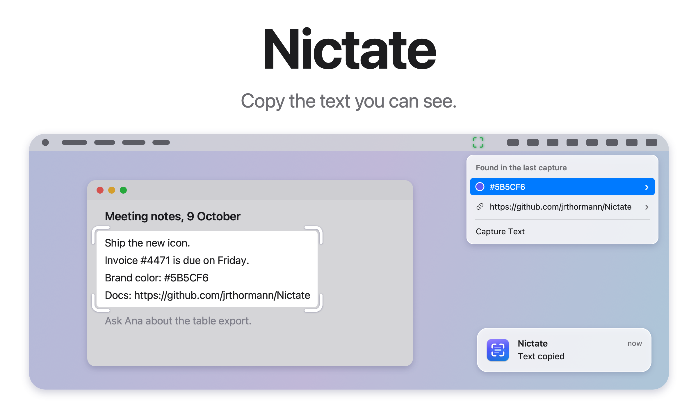
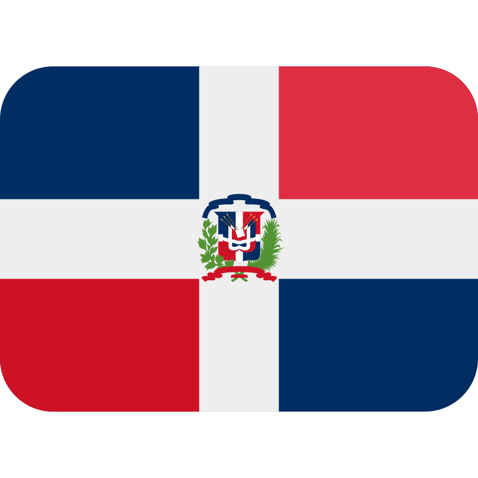
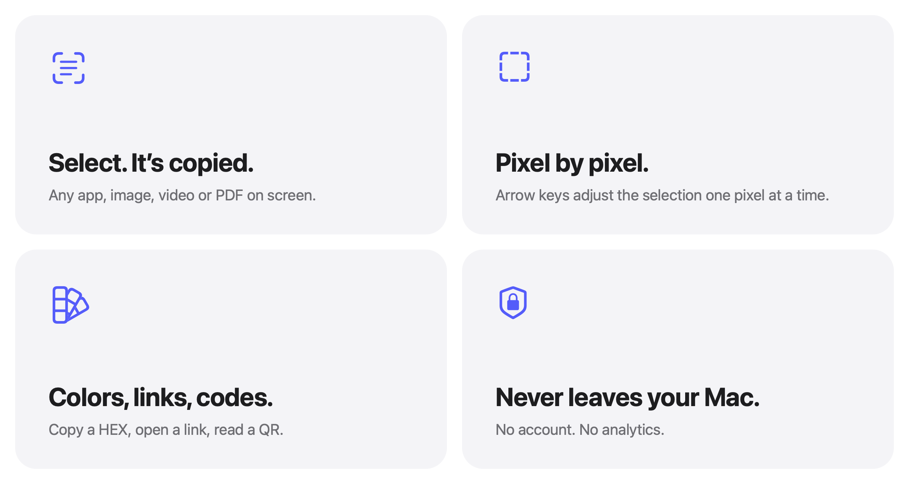
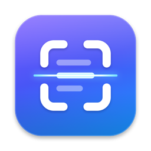

<picture>
  <source media="(prefers-color-scheme: dark)" srcset="docs/images/hero-dark.png">
  
</picture>

<p align="center">
  <a href="https://github.com/jrthormann/Nictate/actions/workflows/ci.yml"></a>
  <a href="https://github.com/jrthormann/Nictate/releases"></a>
  <a href="LICENSE"></a>
</p>

<p align="center">
  An independent, open-source macOS utility built to make text on your screen usable.
  <br>
  <a href="https://github.com/jrthormann/Nictate/releases">Download&nbsp;&rsaquo;</a>
  &nbsp;&nbsp;
  <a href="#build-from-source">Build it yourself&nbsp;&rsaquo;</a>
  <br><br>
  Made in the Dominican Republic , powered by Coke Zero and pizza.
  <br><br>
  English&nbsp;·&nbsp;<a href="docs/i18n/README.es.md">Español</a>
</p>

<br>

## Select. Copy. Move on.

Some text on your screen just won't let you copy it. Nictate grabs it for you.

Press <kbd>⇧</kbd>&thinsp;<kbd>⌘</kbd>&thinsp;<kbd>2</kbd> and drag over whatever has words on it: a web page, a
photo of a whiteboard, a paused video, a slide someone is sharing. The text lands on your clipboard in a fraction
of a second.

It all happens on your Mac, using Apple's Vision framework, in any language Vision reads. Nothing gets uploaded.
Your other problems are still yours, sorry.

<br>

## Pixel by pixel.

<picture>
  <source media="(prefers-color-scheme: dark)" srcset="docs/images/bento-dark.png">
  
</picture>

<br>
<br>

Selections snap to whole screen pixels, so every edge sits exactly where you put it. The arrow keys move the
corner one pixel at a time, and Shift plus an arrow moves it ten. It works the same way as the system screenshot
tool, so it'll feel familiar.

<br>

## It knows what it's reading.

Nictate can tell code, tables, lists and plain prose apart, and it keeps each one the way it was written. Code
keeps its line breaks and indentation. Tables paste with tabs between the cells, so they drop straight into a
spreadsheet. Only ordinary prose gets joined into paragraphs, which means a list never turns into a sentence.

Colors, links, emails and phone numbers from your last capture are one click away in the menu. QR codes and
barcodes copy their contents. A link inside one gets copied, or opens only after you confirm the address, whichever
you prefer.

<br>

## Shortcuts

| Shortcut | What it does |
|:--|:--|
| <kbd>⇧</kbd>&thinsp;<kbd>⌘</kbd>&thinsp;<kbd>2</kbd> | Select an area and copy its text. |
| <kbd>⌥</kbd>&thinsp;<kbd>⇧</kbd>&thinsp;<kbd>⌘</kbd>&thinsp;<kbd>2</kbd> | Cycle through your recent captures. |
| Arrow keys, or <kbd>⇧</kbd> with an arrow | Move the selection corner one pixel, or ten. |
| <kbd>Return</kbd> | Start a corner from the keyboard, then press it again to copy. |
| <kbd>Esc</kbd> | Cancel the selection. |

You can change any shortcut in Settings. Every shortcut needs <kbd>⌘</kbd> or <kbd>⌃</kbd>, so ordinary typing never
fires a capture by accident. The shortcut for codes alone is optional.

<br>

## Private by design.

No account and no analytics. If you turn on Save Captures, the 15 most recent captures are kept in a plain file on
your Mac. Nictate doesn't encrypt that file, so turn saving off or clear the file whenever you like.

Nictate makes no network requests of its own, except Check for Updates, and only when you ask it to. A link you
choose to open goes to your browser, which connects the way it normally would. To report a security problem, see [SECURITY.md](SECURITY.md).

<br>

## Tech specs

| | |
|:--|:--|
| **Compatibility** | Built for macOS. Minimum deployment target: macOS 14 Sonoma, on Apple silicon and Intel. Tested by the maintainer on macOS 27. |
| **Size** | About 4 MB |
| **Languages** | English and Spanish. Text is recognized in every language Vision supports. |
| **Built with** | Swift, AppKit, SwiftUI, Vision and ScreenCaptureKit |
| **Network access** | Only Check for Updates, and only when you ask. Links open in your browser only when you choose. |
| **Price** | Free |
| **License** | MIT |

<br>

## Status

Nictate 1.0.0-beta.2 is an experimental public beta. It works, and I've tested it on macOS 27. I haven't tried it on
macOS 14, 15 or 26 yet, and VoiceOver support hasn't been audited. Reports are welcome. The
[CHANGELOG](CHANGELOG.md) lists what's tested and what isn't. Nictate started as a side project, and this beta shows whether it is useful to other people.

If you have 1.0.0-beta.1, download beta.2 from the [Releases page](https://github.com/jrthormann/Nictate/releases). Beta.1 reports itself as version 1.0.0, so its Check for Updates can't find beta.2.

## Install

Download the disk image from the [releases page](https://github.com/jrthormann/Nictate/releases), open it, and drag Nictate into Applications. Each release lists the image's SHA-256 checksum.

Nictate is an independent project. It is signed with a local certificate, not an Apple Developer ID certificate, and Apple has not notarized it. macOS may block the first launch with a warning. This is expected for this experimental beta. To open Nictate, use the system's own controls:

- **macOS 15 and later:** open System Settings, go to **Privacy & Security**, and click **Open Anyway** next to the message about Nictate.
- **macOS 14:** Control-click Nictate, choose **Open**, then **Open** again.

On first launch, a welcome window asks for the **Screen Recording** permission. Grant it, then restart Nictate from
that window. macOS only applies the permission to an app that was just launched.

<br>

## Build from source

You need macOS 14 or later and the Command Line Tools (`xcode-select --install`). You don't need Xcode.

```sh
git clone https://github.com/jrthormann/Nictate.git
cd Nictate
make install
```

`make install` builds the app, copies it to Applications and opens it. `make check` runs the tests.

<br>

## Support the Project

If Nictate saves you some time, you can chip in through Buy Me a Coffee or PayPal. It's entirely optional, and it
goes toward maintenance, fixes and whatever comes next.

[](https://www.buymeacoffee.com/jrthormann)
[](https://paypal.me/jrthormann)

<br>

## Contributing

Bug reports, ideas and pull requests are all welcome. [CONTRIBUTING.md](CONTRIBUTING.md) covers how to report a bug,
propose a change, build, run the tests and send a pull request. Translations live in `Sources/Nictate/Resources/`,
one `.lproj` folder per language, and `make strings` makes sure none is missing. [docs/ARCHITECTURE.md](docs/ARCHITECTURE.md)
walks through each file. The test releases are on the [Releases page](https://github.com/jrthormann/Nictate/releases). Security problems are reported privately, as [SECURITY.md](SECURITY.md) explains.

<br>

---

<sub>
Nictate is licensed under the MIT License; see <a href="LICENSE">LICENSE</a>. It uses only Apple system frameworks,
and GitHub's public release list for Check for Updates. Release notes are in <a href="CHANGELOG.md">CHANGELOG.md</a>.
</sub>

<br>
<br>

<p align="center">
  
  <br>
  <sub>Copy the text you can see. No cloud, no tracking, no bullshit.</sub>
  <br><br>
  <sub>🇩🇴 Built in the Dominican Republic. Runs on Coke Zero, pizza, and questionable life choices. If it works, it's a feature. If it breaks, it's open source.</sub>
</p>
