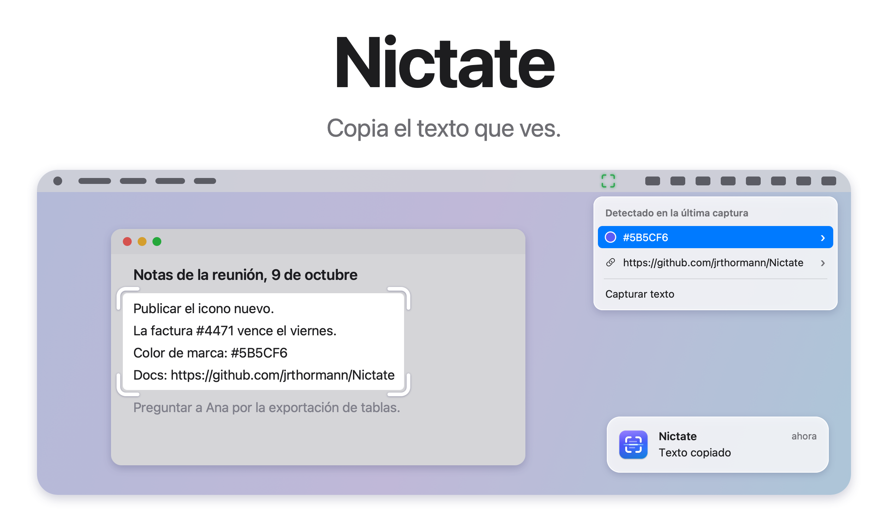
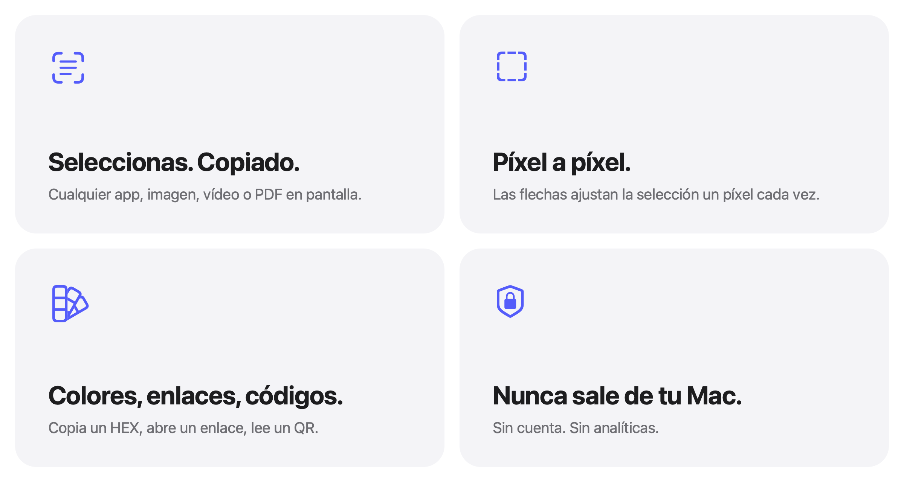

<picture>
  <source media="(prefers-color-scheme: dark)" srcset="../images/es/hero-dark.png">
  
</picture>

<p align="center">
  <a href="https://github.com/jrthormann/Nictate/actions/workflows/ci.yml"></a>
  <a href="../../LICENSE"></a>
</p>

<p align="center">
  Una utilidad independiente y de código abierto para macOS, hecha para que el texto de tu pantalla sea utilizable.
  <br><br>
  <a href="https://github.com/jrthormann/Nictate/releases"></a>
  <br><br>
  macOS 14 o posterior &nbsp;·&nbsp; Apple silicon e Intel &nbsp;·&nbsp; Gratis, licencia MIT
  <br><br>
  <a href="#compilar-desde-el-código">Compilarla tú mismo&nbsp;&rsaquo;</a>
  <br><br>
  Hecha en República Dominicana , con Coke Zero y pizza como combustible.
  <br><br>
  <a href="../../README.md">English</a>&nbsp;·&nbsp;Español
</p>

> [!IMPORTANT]
> Esta beta no está notarizada por Apple, así que macOS te pide aprobar Nictate una vez, al abrirla por primera vez. Los pasos están en [Instalación](#instalación) y en la [guía de instalación](INSTALL.es.md). No necesitas desactivar Gatekeeper.

<br>

## Seleccionas. Copias. Sigues.

Hay texto en tu pantalla que no te deja copiarlo. Nictate lo agarra por ti.

Pulsa <kbd>⇧</kbd>&thinsp;<kbd>⌘</kbd>&thinsp;<kbd>2</kbd> y arrastra sobre lo que tenga letras: una página web, la
foto de una pizarra, un video en pausa, una diapositiva que alguien comparte. En una fracción de segundo, el texto
ya está en tu portapapeles.

Todo ocurre en tu Mac, con el framework Vision de Apple, en cualquier idioma que Vision lea. No se sube nada.
Tus otros problemas, lamentablemente, siguen siendo tuyos.

<details>
<summary><strong>¿Por qué Nictate?</strong></summary>

Ponerle nombre a una app debería ser fácil. Debería.

Todos los nombres buenos estaban cogidos. Blink ya no era una opción. Y Parpadeo, muy bonito en español, pero pon a alguien que habla inglés a pronunciarlo.

Así que hice lo más lógico: le di demasiadas vueltas, me puse filosófico y, por alguna razón, terminé leyendo terminología médica. Ahí apareció nictate.

Una palabra real en inglés que significa parpadear.

Toda esa investigación para ponerle nombre a una app que copia texto de la pantalla.

En fin. Nictate.

</details>

<br>

## Píxel a píxel.

<picture>
  <source media="(prefers-color-scheme: dark)" srcset="../images/es/bento-dark.png">
  
</picture>

<br>
<br>

La selección encaja en píxeles enteros de la pantalla, así que cada borde cae justo donde lo pusiste. Funciona igual
que la herramienta de capturas de pantalla del sistema, así que te va a sonar.

<br>

## Sabe lo que lee.

Nictate distingue código, tablas, listas y texto corrido, y deja cada uno como estaba escrito. El código conserva
sus saltos de línea y su sangría. Las tablas se pegan con tabuladores entre las celdas, así que caen directo en una
hoja de cálculo. Solo el texto corrido se une en párrafos, para que una lista nunca se convierta en una oración.

Los colores, enlaces, correos y teléfonos de tu última captura están a un clic en el menú. Los códigos QR y de
barras copian su contenido. Un enlace dentro de uno se copia, o se abre solo después de que confirmes la dirección,
como prefieras.

<br>

## Atajos

| Atajo | Qué hace |
|:--|:--|
| <kbd>⇧</kbd>&thinsp;<kbd>⌘</kbd>&thinsp;<kbd>2</kbd> | Selecciona un área y copia su texto. |
| <kbd>⌥</kbd>&thinsp;<kbd>⇧</kbd>&thinsp;<kbd>⌘</kbd>&thinsp;<kbd>2</kbd> | Abre Capturas recientes: las flechas eligen, <kbd>Intro</kbd> copia y <kbd>Esc</kbd> cierra. |
| Flechas, o <kbd>⇧</kbd> con una flecha | Mueve la esquina de la selección un píxel, o diez. |
| <kbd>Return</kbd> | Empieza una esquina desde el teclado; pulsa otra vez para copiar. |
| <kbd>Esc</kbd> | Cancela la selección. |

Puedes cambiar cualquier atajo en Ajustes. Todos necesitan <kbd>⌘</kbd> o <kbd>⌃</kbd>, así que escribir normal nunca
dispara una captura por accidente. El atajo solo para códigos es opcional.

<br>

## Privado por diseño.

Sin cuenta y sin analíticas. Si activas Guardar capturas, las 15 más recientes se guardan en un archivo normal dentro
de tu Mac. Nictate no cifra ese archivo, así que desactiva el guardado o borra el archivo cuando quieras.

Nictate no hace peticiones de red por su cuenta, salvo Comprobar actualizaciones, y solo cuando tú lo pides. Un enlace
que decides abrir pasa a tu navegador, que se conecta como siempre. Para reportar un problema de seguridad, consulta [SECURITY.md](../../SECURITY.md).

<br>

## Especificaciones

| | |
|:--|:--|
| **Compatibilidad** | Hecha para macOS. Versión mínima de despliegue: macOS 14 Sonoma, en Apple silicon e Intel. Probada por el autor en macOS 27. |
| **Tamaño** | Unos 4 MB |
| **Idiomas** | Inglés y español. El texto se reconoce en cualquier idioma que Vision admita. |
| **Hecha con** | Swift, AppKit, SwiftUI, Vision y ScreenCaptureKit |
| **Precio** | Gratis |
| **Licencia** | MIT |

<br>

## Estado

Nictate 1.0.0-beta.3 es la versión de prueba pública actual: una beta pública experimental. Los builds de esta versión
se probaron en macOS 27. Todavía no la he probado en macOS 14, 15 ni 26, y VoiceOver no ha pasado por una auditoría. Los reportes son
bienvenidos. El [CHANGELOG](../../CHANGELOG.md) dice qué se ejecutó y qué no.

La 1.0.0-beta.2 es el prelanzamiento público anterior y sigue disponible en la [página de Releases](https://github.com/jrthormann/Nictate/releases).

## Instalación

Descarga la imagen de disco solo desde la [página de versiones](https://github.com/jrthormann/Nictate/releases), ábrela y
arrastra Nictate a Aplicaciones. Como esta beta no está notarizada, macOS te pide aprobar Nictate una vez. Los pasos
completos, el permiso de Grabación de pantalla, la comprobación de la suma y la actualización desde la beta.1 están en la
[guía de instalación](INSTALL.es.md).

<br>

## Compilar desde el código

Necesitas macOS 14 o posterior y las herramientas de línea de comandos (`xcode-select --install`). No necesitas Xcode, que es una cosa menos que instalar.

```sh
git clone https://github.com/jrthormann/Nictate.git
cd Nictate
make install
```

`make install` compila la app, cierra Nictate si está abierta, reemplaza `/Applications/Nictate.app` por la nueva versión y la abre. `make check` ejecuta las pruebas.

<br>

## Apoya el proyecto

Si Nictate te ahorra tiempo, puedes apoyarlo con Buy Me a Coffee o PayPal. Es totalmente opcional, y lo que llegue
sirve para el mantenimiento, las mejoras y lo que venga después.

[](https://www.buymeacoffee.com/jrthormann)
[](https://paypal.me/jrthormann)

<br>

## Contribuir

Los reportes, las ideas y las pull requests son bienvenidos. [CONTRIBUTING.md](../../CONTRIBUTING.md) explica cómo
reportar un error, proponer un cambio, compilar, ejecutar las pruebas y enviar una pull request. Las traducciones
están en `Sources/Nictate/Resources/`, una carpeta `.lproj` por idioma; `make strings` se asegura de que no falte
ninguna. [docs/ARCHITECTURE.md](../ARCHITECTURE.md) explica cada archivo. La última versión de prueba está en la
página de [Releases](https://github.com/jrthormann/Nictate/releases). Los problemas de seguridad se reportan en privado, como explica [SECURITY.md](../../SECURITY.md).

<br>

---

<sub>
Nictate se distribuye bajo la licencia MIT; ver <a href="../../LICENSE">LICENSE</a>. Solo usa frameworks del sistema
de Apple y, si lo pides, la lista pública de versiones de GitHub para Comprobar actualizaciones. Las notas de cada
versión están en <a href="../../CHANGELOG.md">CHANGELOG.md</a>.
</sub>

<br>
<br>

<p align="center">
  
  <br>
  <sub>Copia el texto que ves. Sin nube, sin rastreo.</sub>
</p>
